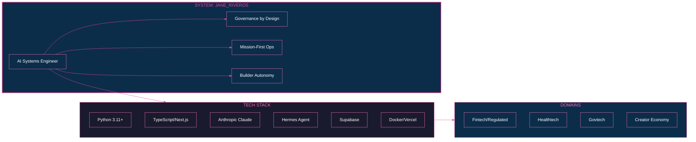
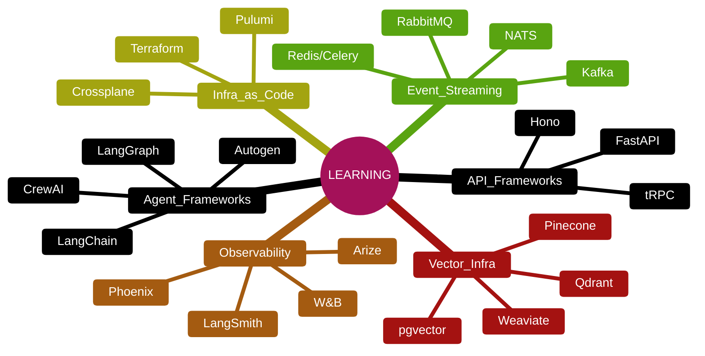
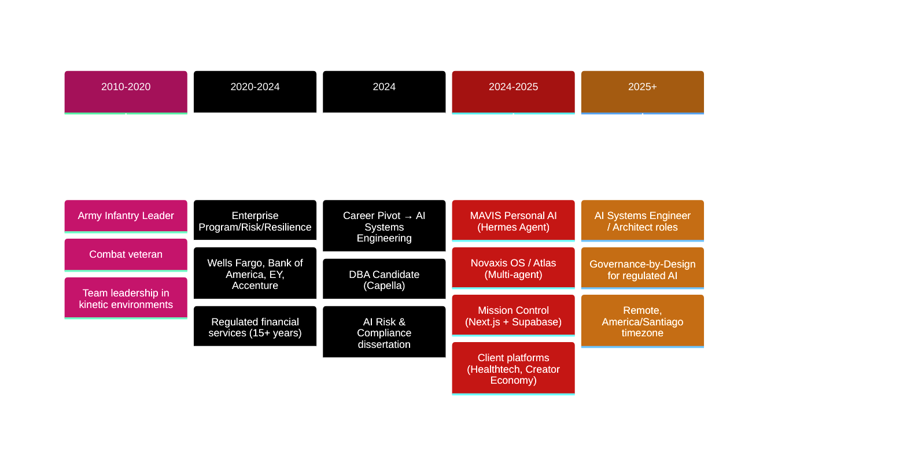

# Jane Riveros
**AI Systems Engineer** · Governance-by-Design · Santiago, Chile 🇨🇱  
*Inglés fluido · Español nativo* | America/Santiago timezone (UTC-3/UTC-4)

[](https://linkedin.com/in/janeriveros)
[](mailto:jdriveros232@gmail.com)
[](https://github.com/testaiprojects1-sketch)
[](https://janeriveros.com)

---



---

### `>_ WHAT I BUILD`
```
Production AI systems that PASS AUDIT
├── Agents & automation for regulated environments
├── Decision pipelines with full traceability
├── Eval harnesses + compliance guardrails (day one)
└── Operational clarity — no black boxes
```

**Domains:** `fintech` `healthtech` `govtech` `legal-compliance` `creator-economy`

---

### `>_ CORE STACK` *(daily drivers)*

| Layer | Tech |
|-------|------|
| **AI/ML** | `Anthropic Claude Opus/Sonnet` `OpenAI` `ElevenLabs` `faster-whisper (local)` |
| **Agent/Orchestration** | `python-telegram-bot` `APScheduler` `Hermes Agent (SOUL.md)` `custom tool registry` |
| **Backend** | `Python 3.11+` `Next.js 14/15 App Router` `Supabase (PostgreSQL + Auth + Realtime)` |
| **Frontend** | `React 18/19` `TypeScript` `Three.js (@react-three/fiber)` `Framer Motion` `GSAP` `Tailwind CSS` |
| **Process/BPMN** | `bpmn-js` `custom orchestration patterns` |
| **Data/Infra** | `Supabase` `Docker` `Vercel` `yt-dlp` `python-docx/pptx/PyPDF2` |
| **Integrations** | `Notion API` `Slack Bolt` `DuckDuckGo Search` `ElevenLabs` `n8n (cloud webhooks)` |
| **Observability** | `Structured logging` `custom eval scripts (private)` `Sentry (config)` |

**Governance built-in:** `Custom eval frameworks` `Structured audit logs` `Model cards` `Risk registers` `SOUL.md guardrails` `Threshold gates`

---

### `>_ FEATURED WORK` *(public showcases — architecture, diagrams, demos)*

| # | Project | Problem | Demo | Architecture | Stack |
|---|---------|---------|------|--------------|-------|
| 1 | **[Novaxis OS / Atlas](https://github.com/testaiprojects1-sketch/novaxis-showcase)** | Multi-agent OS for regulated trading workflows | [🎥 Demo](https://...) | [📐 System](https://github.com/testaiprojects1-sketch/novaxis-showcase/blob/main/ARCHITECTURE.md) | `Next.js` `Three.js` `Supabase` `BPMN.js` |
| 2 | **[MAVIS — Personal AI](https://github.com/testaiprojects1-sketch/mavis-showcase)** | Telegram AI agent with tools, memory, voice, governance | [🎥 Demo](https://...) | [📐 System](https://github.com/testaiprojects1-sketch/mavis-showcase/blob/main/ARCHITECTURE.md) | `Python` `Hermes Agent` `Anthropic` `ElevenLabs` |
| 3 | **[Mission Control](https://github.com/testaiprojects1-sketch/mission-control-showcase)** | Cloud dev environment for AI trading advisory | [🎥 Demo](https://...) | [📐 System](https://github.com/testaiprojects1-sketch/mission-control-showcase/blob/main/ARCHITECTURE.md) | `Next.js 15` `React 19` `Supabase` `BPMN.js` |
| 4 | **[Dental Clinic Platform](https://github.com/testaiprojects1-sketch/dental-clinic-showcase)** | Patient management + 3D consultation panel (GDPR) | [🎥 Demo](https://...) | [📐 System](https://github.com/testaiprojects1-sketch/dental-clinic-showcase/blob/main/ARCHITECTURE.md) | `Next.js` `TypeScript` `Supabase` `Three.js` |
| 5 | **[Tattoo Artist Platform](https://github.com/testaiprojects1-sketch/tattoo-platform-showcase)** | Artist portfolio + course marketplace (Stripe) | [🎥 Demo](https://...) | [📐 System](https://github.com/testaiprojects1-sketch/tattoo-platform-showcase/blob/main/ARCHITECTURE.md) | `Next.js` `React` `Tailwind` `Stripe` |

> **Note:** These are **public showcases** — architecture, diagrams, results, demo videos.  
> Full implementation repos are **private**; shared in technical interviews under NDA.

---

### `>_ FAMILIAR WITH / LEARNING`



---

### `>_ CURRENTLY EXPLORING`

- **Formal verification** for critical agent paths (TLA+, Alloy)
- **Model Context Protocol (MCP)** for standardized tool interfaces
- **Nostr/Buzz** for decentralized agent coordination (local relay running)
- **On-device LLMs** (llama.cpp, MLX) for privacy-first deployments
- **AI safety/alignment** (Constitutional AI, RLAIF, mechanistic interpretability)

---

### `>_ OPERATING PRINCIPLES`

| Principle | In Practice |
|-----------|-------------|
| **`GOVERNANCE BY DESIGN`** | Eval harnesses, audit trails, risk registers ship *with* the feature — not after |
| **`MISSION-FIRST / OPERATIONAL CLARITY`** | Army infantry leader → own outcomes, explicit trade-offs, calm under pressure |
| **`SYSTEMS OVER CHAOS`** | Autistic/structured thinker: explicit architecture, ADRs, version-controlled diagrams |
| **`ASYNC BY DEFAULT`** | Santiago-based, remote-first: deep-work blocks, written comms, timezone-aware |
| **`BUILDER AUTONOMY`** | Founding-engineer mindset: idea → spec → ship → measure → iterate |

---

### `>_ BACKGROUND`

```
├── DBA Candidate (Capella) — Dissertation: AI Risk & Compliance in Regulated Financial Services
├── Former Army Infantry Leader — Combat veteran, medically retired; led teams in kinetic environments
├── Career Pivot → Full-time DBA + AI systems builder in public (2024–present)
└── Location: Santiago, Chile | Dual US/CL citizen | Remote-first, open to travel
```

---

### `>_ FOR EMPLOYERS`

**Seeking:** `AI Systems Engineer` `AI Architect` `Founding Engineer`  
**Focus:** Startups building in regulated spaces (fintech, healthtech, govtech, legal-compliance)  
**Availability:** Full-time, remote, **America/Santiago** (overlaps US East Coast mornings, EU afternoons)

**Fastest contact:**  
```bash
$ mail jdriveros232@gmail.com    # Reply within 4 hrs business days
$ open https://linkedin.com/in/janeriveros
```

**Proof of work:**
- 🎥 **Novaxis OS Demo** — Multi-agent orchestration with governance layer
- 🎥 **MAVIS Demo** — Personal AI agent with tools, voice, memory, governance
- 🎥 **Mission Control Demo** — Cloud dev environment for AI trading advisory
- 📄 **DBA Dissertation Abstract** — AI risk framework for banking audit

---

### `>_ TECH DEPTH` *(what actually ships)*

Every system I build includes:
```
✓ Structured audit logging (trace IDs, prompt/response hashes, latency, token counts)
✓ Custom eval harness with regression + red-team gates
✓ SOUL.md / guardrail layer defining behavioral boundaries
✓ Threshold-based deployment gates (no "vibe checks" to prod)
```

---



---

*Last updated: November 2025* — *Open to conversations about AI systems that must pass audit.*  

---

<p align="center">
  
  
  
</p>